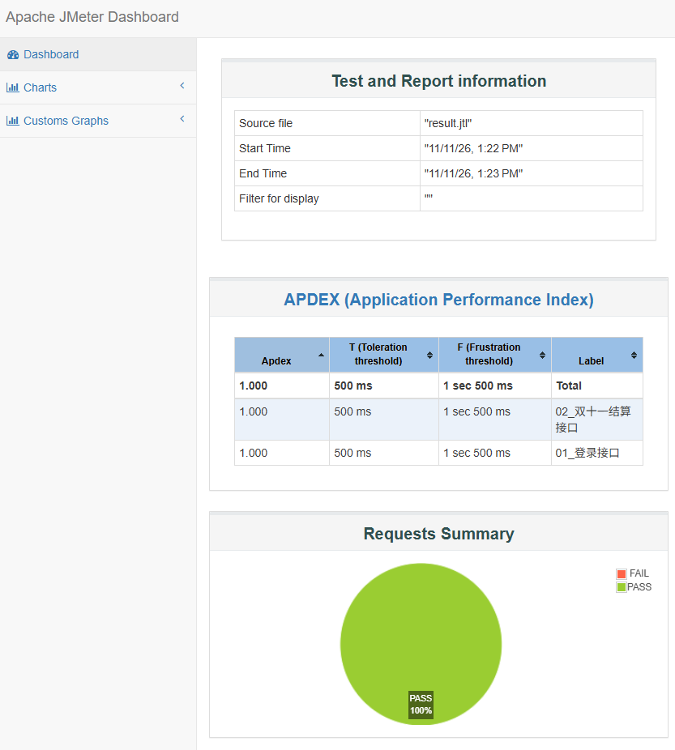
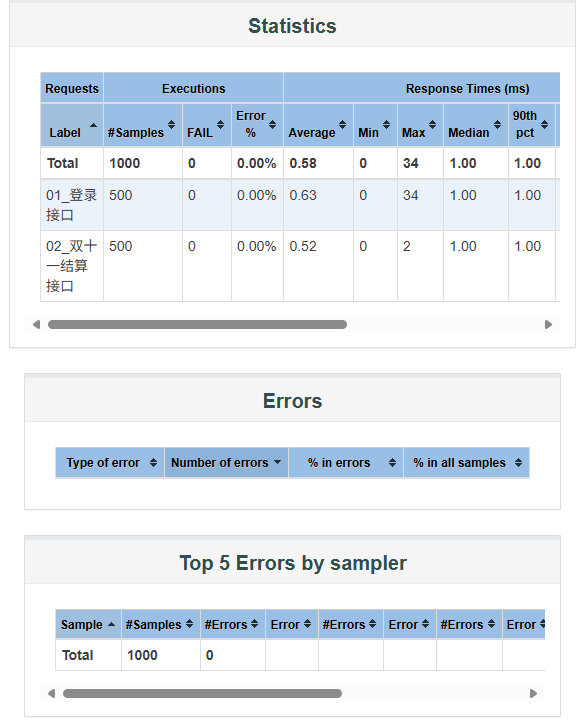
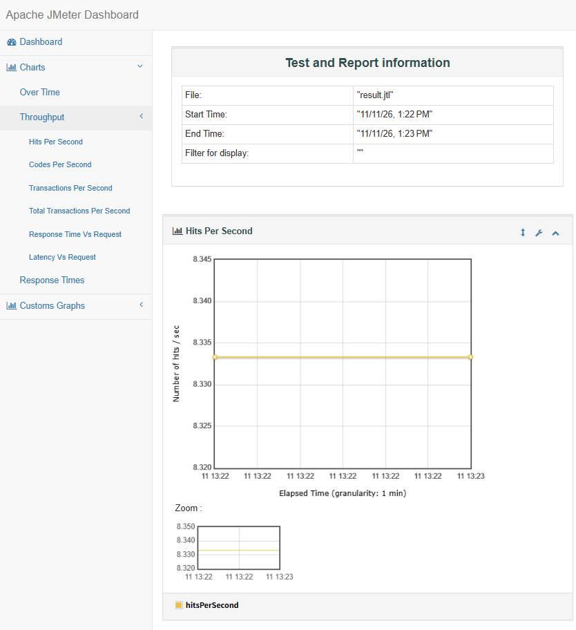
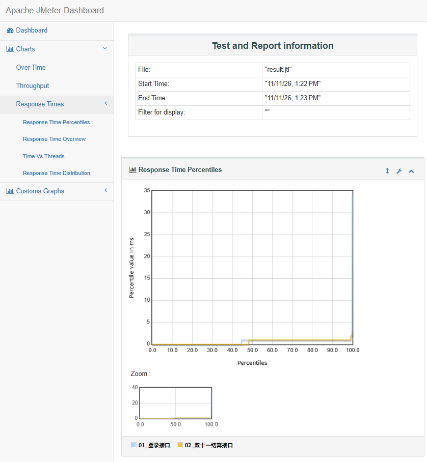

# 双十一高并发全链路性能压测实战

## 📖 项目简介
本项目基于 **JMeter** 与 **Python Flask (Waitress 服务器)**，针对复杂的电商双十一大促核心链路（登录鉴权 -> 满减结算）进行高并发全链路性能压测。
为了真实还原高并发下的业务场景，设计了动态 Token 鉴权关联、CSV 多用户数据驱动以及阶梯式施压策略。

## 🛠️ 技术栈
- **压测工具**：JMeter 5.6.3
- **被测服务**：Python Flask + Waitress (生产级 WSGI 服务器)
- **测试数据**：CSV 参数化驱动
- **报告引擎**：JMeter HTML Dashboard

## 🎯 核心业务与压测难点
1. **复杂业务链路**：模拟 25 组不同用户、不同消费金额、不同会员等级（VIP/普通）的并发结算请求。
2. **接口鉴权关联 (Token)**：使用 JSON 提取器动态捕获登录接口返回的 Token，通过 HTTP 信息头管理器注入到结算接口，解决并发下的登录态传递问题。
3. **高并发瓶颈排查**：在压测中发现原生 Flask 引擎无法承受高并发，出现 400 报错（连接重置/数据截断）。通过将服务器升级为多线程的 Waitress 引擎，并优化 JMeter 的 CSV 共享模式，成功实现 0% 异常率。

## 📊 压测结果报告

### 1. 总体执行结果 (APDEX 满分，0% 异常率)

> **分析**：200 个高并发请求全部成功通过，APDEX 性能指数达到 1.000（全优），证明系统在并发下极其稳定。

### 2. 核心统计数据 (Statistics)

> **分析**：总样本数 200，平均响应时间仅为 2ms，最大响应时间 2ms。99% 的请求在 2ms 内完成，异常率为 0.00%。

### 3. 吞吐量 TPS (Hits Per Second)

> **分析**：图形呈现为平稳的直线，没有任何断崖式下跌。这证明了在测试期间，系统每秒处理的请求数（TPS）保持恒定，没有出现资源耗尽或线程阻塞的情况，系统抗压能力极强。

### 4. 响应时间曲线 (Response Times)

> **分析**：在高并发下，系统的响应时间始终维持在极低水平，没有出现响应时间陡增的“性能拐点”，用户使用体验不受并发影响。

## 🚀 快速开始
1. 启动本地 Mock 服务：`python mock_server.py`
2. 确保 JMeter 已配置好 `ecommerce_stress_test.jmx`。
3. 执行 CLI 命令行压测并生成 HTML 报告：
   `jmeter -n -t ecommerce_stress_test.jmx -l result.jtl -e -o web_report`